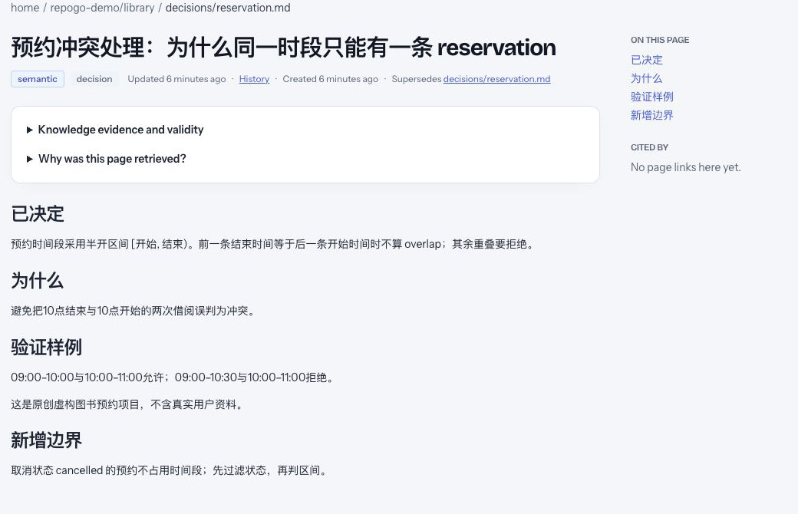

# 项目决策别再重讲！把原因存下来，下次搜回原文

这是 [ai-memory](https://github.com/akitaonrails/ai-memory) 的原创中文练习包，固定官方 **3.3.1**。它给开发助手提供一份独立于聊天窗口的项目记忆：决策和原因写成普通 Markdown，可以检索；收工时另存下一步，接手方领取后就不再重复分配。

我们没有给现有助手安装插件或读取你的会话。这份练习通过官方接口做两件事：**找回长期决策**，以及**传递一次性的下一步**。本轮 macOS Apple Silicon 实跑；Linux、Windows 入口仅按官方资料整理，未实测。向量搜索、自动捕获和模型整理没有测试，不把它们当本轮成果。



## 先找回“为什么这么定”

假设你写的是一个图书预约程序。以前决定过：9点到10点、10点到11点的两次预约可以接着用；9点到10点半与10点到11点则冲突。几天后继续开发，只看代码中的条件，很容易忘记这条规则的原因。

练习先把决定、理由和两个边界样例保存到 `decisions/reservation.md`。随后用“预约”检索，打开命中的完整正文。再增加“已取消的预约不占时间段”，新内容被保存为新版本；服务停止重启后仍能读回。这里程序负责存储、索引和找回，文字和业务规则由我们编写，没有模型自动作决定。

## 再交代“下一步做到哪里”

长期决定不应该和收工待办混在一起。第二个练习留下：“规则已保存，提交接口尚未实现；接下来实现区间判断并补三个测试。”调用官方 handoff 接口后，接手客户端先列出待办，再按准确编号领取。

实测第一次返回 `claimed`，第二次是 `none_pending`。它的用途是一次交接，而不是可反复查阅的知识页。这只是两个客户端请求对交接协议的演示；没有运行 Claude Code 或 Codex 的自动接续，也没有把记忆内容当作新的操作授权。

## 跑一次

macOS Apple Silicon 需要 Python 3、网络，自动入口下载约20MB的官方发布归档并核对固定SHA256。在当前目录先运行：

```sh
sh start.sh
```

保持服务窗口，再开一个终端到同一目录：

```sh
python3 exercise.py
```

成功会显示 `passed: true`、`second_claim: none_pending` 和本次项目的网页地址。用浏览器打开它看原生知识页；练习的完整请求与响应在 `output/`。每次使用新项目名，不覆盖前一次练习。按服务窗口的 Ctrl+C 停止，数据仍在 `.runtime/demo-data`；下次启动继续保留。

想自动核对完整练习、停启和持久化，运行 `python3 verify.py`。这会使用独立18684端口和临时原创样例数据，结束后停止服务。

这是只监听127.0.0.1、没有账号鉴权的原创样例实例，不是私人聊天导入入口。实际部署采用官方 `init` 和鉴权方案，接入哪个助手与捕获哪些内容由你另行配置。

## 交付内容

- [从这里开始](START_HERE.md)：第一次运行与成功标志。
- [完整运行说明](RUN.md)：数据位置、停启、三系统边界、官方私人部署入口。
- [常见问题](FAQ.md)：连不上、中文检索和模型下载的区别。
- [实际验证](VERIFIED_RUN.md)：本轮证据能说明什么、不能说明什么。
- [来源与许可](ATTRIBUTION.md)、[服务边界](SERVICE.md)。

仓库只包含RepoGo原创文档、启动脚本、样例与本次截图；不镜像上游源码或分发其二进制。官方项目已有中文可用的页面内容能力，本包不是全界面汉化。图文与脚本由AI辅助制作，结果经过真实官方程序读回。
