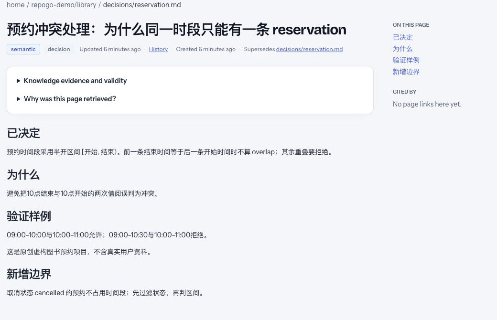

# 从这里开始

用途：用两段原创内容练习保存项目决策与交接待办，不读取现有聊天。

1. macOS Apple Silicon 安装 Python 3，然后解压进入本目录。首次启动需要网络，官方归档约20MB，无需模型API key。
2. 执行 `sh start.sh`。它下载并验证ai-memory3.3.1，生成独立`.runtime/demo-data`，打开本地18683端口；保持窗口运行。
3. 另开终端进入同目录，运行 `python3 exercise.py`。输出应有`passed: true`和`second_claim: none_pending`。
4. 打开输出里的`url`，进入Knowledge查看“预约”决策；也可从`http://127.0.0.1:18683/web`选本次library项目。
5. 查看`output/library-.../`内真实请求响应；决策修改后应多出“已取消cancelled不占用时间段”。领取过的handoff不再出现。
6. 回到服务窗口按Ctrl+C停止，重启仍保留原项目。不要删除`.runtime/demo-data`来排一般故障。

原生界面：

这是原创样例、仅本机loopback、无账号鉴权的练习服务。不放私聊、密钥或工作资料。实际私人部署与助手接入先看RUN.md；本包不会替你配置hook。

**Linux/Windows未实测。**按RUN.md取得对应官方3.3.1二进制，再传`--binary`。`start.cmd`只转交给Python，不代表Windows原生核心已通过。
